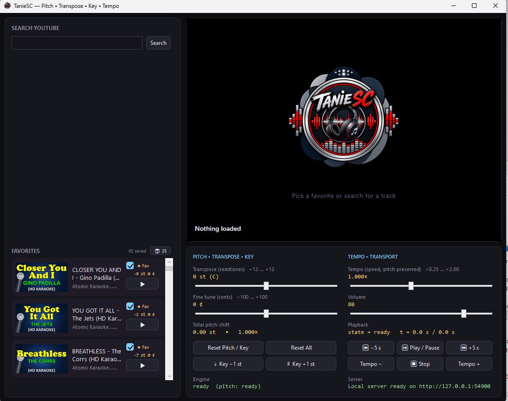

# TanieSC YT Player

> A desktop YouTube player for musicians, karaoke singers, and anyone who needs **independent pitch and tempo control** on YouTube content.

TanieSC YT Player is a WPF desktop application that plays YouTube audio through a custom DSP pipeline — letting you **transpose in semitones**, **fine-tune in cents**, and **change tempo without affecting pitch**, all in real time.

[](https://opensource.org/licenses/MIT)

<p align="center">
  
</p>

---

## Table of Contents

- [Features](#features)
- [Requirements](#requirements)
- [Installation](#installation)
- [Usage](#usage)
- [How It Works](#how-it-works)
- [Project Structure](#project-structure)
- [Troubleshooting](#troubleshooting)
- [Roadmap](#roadmap)
- [Contributing](#contributing)
- [License](#license)
- [Disclaimer](#disclaimer)

---

## Features

### Playback
- 🎵 **Search YouTube** directly from the app — no browser required
- 🎬 **Full video playback** at up to 720p (AVC preferred for hardware decode)
- 🔊 **Separate audio track** for high-quality DSP processing
- 📺 **MSE-based pipeline** for reliable, drift-free A/V sync
- ⏯️ **Play / pause / stop / seek** controls with keyboard-friendly buttons
- 🔁 **Instant resume** — Stop preserves the buffer, so Play starts without re-buffering

### Pitch & Tempo
- 🎼 **Independent pitch shifting** — transpose from −12 to +12 semitones
- 🎚️ **Fine pitch trim** — ±100 cents for out-of-tune recordings
- ⏩ **Tempo control** — 0.25× to 4.0× with pitch preserved (via native `preservesPitch`)
- 🧠 **Powered by SoundTouch** — runs inside an AudioWorklet on a dedicated audio thread, keeping the UI responsive

### Favorites
- ⭐ **Save tracks to favorites** — persisted to `%LOCALAPPDATA%`
- 🎯 **Per-favorite pitch memory** — each favorite remembers its saved semitones/cents/tempo
- 🔀 **Shuffle mode** — play 25 random favorites from your library
- 🖼️ **Thumbnail previews** — see what you're about to play before clicking

### Technical
- 🚀 **Local HTTP proxy** — bypasses YouTube's CORS/signature restrictions
- 🔐 **Optional code-signing ready** — built-in pipeline for Tier 1 licensing
- 📝 **Verbose logging** — every media event written to `player.log` for debugging
- 🎨 **Dark, media-first UI** — built to not distract from the content

---

## Requirements

### To run the app
- **Windows 10** version 1809 or later (Windows 11 recommended)
- **.NET 8 Desktop Runtime** ([download](https://dotnet.microsoft.com/download/dotnet/8.0))
- **WebView2 Runtime** (usually pre-installed; [download if missing](https://developer.microsoft.com/microsoft-edge/webview2/))
- **Internet connection** for YouTube search and playback

### To build from source
- **.NET 8 SDK** ([download](https://dotnet.microsoft.com/download/dotnet/8.0))
- **Visual Studio 2022** (optional but recommended — any edition, including Community)

### Recommended hardware
- Any modern x86-64 CPU (tested on Ryzen 5600G)
- **Hardware H.264 decode** (Intel HD 4000+, AMD Vega+, NVIDIA GT 610+) — strongly recommended for smooth video
- 4 GB RAM minimum, 8 GB recommended for 60+ minute videos

---

## Installation

### From release binary
1. Download the latest `.zip` from [Releases](../../releases).
2. Extract to any folder.
3. Run `TanieSC_YT_Player.exe`.

No installer required. The app is portable — copy the folder to a USB stick and it travels with you.

### Build from source

```bash
git clone https://github.com/TanieSC/TanieSC_YT_Player.git
cd TanieSC_YT_Player
dotnet restore
dotnet build -c Release
dotnet run --project TanieSC_YT_Player

```
---

## Usage

Basic playback
Launch the app.

Type a search query in the Search YouTube box, press Enter.

Double-click a result (or click the ▶ button next to it) to play.

Pitch shifting
Move the Transpose slider to shift by whole semitones (−12 to +12).

Move the Cents slider for fine adjustment (±100 cents = ±1 semitone).

The label below shows the total shift: +3.50 st • 1.222×.

Tempo control
Move the Tempo slider to change playback speed.

Pitch stays constant — you can slow a track to 0.75× without hearing a "chipmunk" or "deep voice" effect.

Saving favorites
Play a track.

Adjust pitch/tempo to your liking.

Click the ★ button on the search result — the track is saved with its current pitch.

Next time, double-click it in the Favorites tab — it plays at the saved pitch automatically. 

---

## How It Works

The app is composed of five cooperating layers:
┌─────────────────────────────────────────────────────────────────────┐
│                        WPF UI (MainWindow.xaml)                     │
│  Search box · Favorites · Pitch/Cents/Tempo sliders · Transport     │
└────────────────────────────┬────────────────────────────────────────┘
                             │ Commands & events
                             ▼
┌─────────────────────────────────────────────────────────────────────┐
│                     C# Services (Services/)                         │
│                                                                     │
│  YouTubeService ──► YoutubeExplode ──► YouTube API                  │
│  StreamProxy    ──► HttpListener    ──► googlevideo.com             │
│  PlayerBridge   ──► ExecuteScriptAsync / WebMessageReceived         │
└────────────────────────────┬────────────────────────────────────────┘
                             │ JSON messages
                             ▼
┌─────────────────────────────────────────────────────────────────────┐
│                   WebView2 Player Page (wwwroot/)                   │
│                                                                     │
│  index.html · yt-app.js · style.css                                 │
│                                                                     │
│  ┌──────────────────────────────────────────────────────────┐       │
│  │  <video>  +  <audio>  OR  MSE MediaSource pipeline       │       │
│  └─────────────────────────┬────────────────────────────────┘       │
│                            │                                        │
│                            ▼                                        │
│  ┌──────────────────────────────────────────────────────────┐       │
│  │  Web Audio Graph                                         │       │
│  │  MediaElementSource ──► AudioWorklet ──► Destination     │       │
│  │                         (SoundTouch DSP)                 │       │
│  └──────────────────────────────────────────────────────────┘       │
└─────────────────────────────────────────────────────────────────────┘
---

## License

MIT — see [LICENSE](LICENSE.txt).

Third-party dependencies and their licenses are listed in [NOTICE](NOTICE.md).

---


